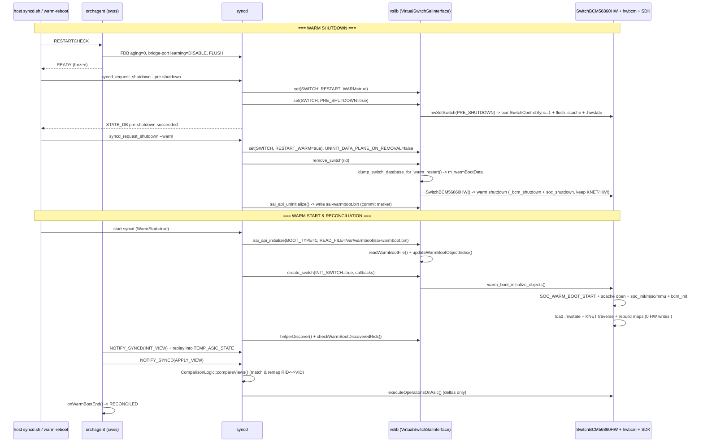

# Warm Reboot / Warm Restart Design for `sai-td2p` (BCM56864 / Trident2+)

**Status:** Research & Design (no code changes)
**Target:** Edgecore AS5812-54T (BCM56864 / Trident2+), SONiC 202505, `sonic-sairedis` (`vslib` + `SwitchBCM56860HW` + `hwbcm`), OpenBCM `sdk-6.5.27`
**Goal:** Achieve data-plane hitless forwarding across SONiC `config warm_restart` (syncd/swss container warm restart) and host `warm-reboot` (kexec), at parity with Broadcom's proprietary XGS SAI.

---

## Executive Summary

Today, restarting `syncd` triggers a full cold initialization of the Trident2+ ASIC (`init soc` → `init misc` → `init mmu` → `init bcm`), tearing down all KNET interfaces, bringing all 72 ports admin-down, clearing all forwarding/ACL/QoS/VXLAN tables, and interrupting traffic for ~2–3 minutes.

Achieving Broadcom-SAI parity requires coordinated changes across **four layers**:

1. **OpenBCM SDK build:** `BCM_WARM_BOOT_SUPPORT` is **not** compiled into our current `sdk-6.5.27` libraries (verified in `sdk_cflags.txt`, `make/Make.local`, and `deploy/build/nm-defined.txt`). The SDK must be rebuilt with `-DBCM_WARM_BOOT_SUPPORT` (and optionally `-DBCM_WARM_BOOT_SUPPORT_SW_DUMP` and `-DSCACHE_CRC_CHECK`).
2. **SDK warm lifecycle (`hwbcm_core.c`):** Implement Level 2 scache backed by a file (`BCM_SWITCH_STABLE_APPLICATION`), `SOC_WARM_BOOT_START` + `soc_init` (`init noreset`) + `soc_misc_init` + `soc_mmu_init` + `bcm_init` on warm start, and `bcmSwitchControlSync` + `bcm_tx_cleanup` + `_bcm_shutdown` + `soc_shutdown` on warm shutdown, with `warmboot_knet_shutdown_mode=1` so KNET netdevs, filters, and DMA rings survive `syncd` restarts untouched.
3. **SAI warm lifecycle (`SwitchBCM56860HW` + `vslib`):** Handle `SAI_SWITCH_ATTR_RESTART_WARM`, `SAI_SWITCH_ATTR_PRE_SHUTDOWN`, and `SAI_SWITCH_ATTR_UNINIT_DATA_PLANE_ON_REMOVAL`; prevent `~SwitchBCM56860HW()` from running cold `hwbcm_deinit()` during warm shutdown; and change `warm_boot_initialize_objects()` from cold-reinit + HW-overwrite to warm attach + zero-HW-write state recovery.
4. **Hardware handle & software state persistence (`.hwstate` sidecar + SDK/vslib rebuild):** `vslib`'s `WarmBootState` already persists all SAI objects, attributes, and OID allocator indices (`RealObjectIdManager`), but does **not** store our dynamically allocated BCM SDK handles (`l3_intf`, `l3_egress`, `ecmp`, `trunk`, `vxlan_vpn`, `tunnel_id`, `vp_gport`, `field_group/entry/stat/range`, `policer`, `qos_map`, `mirror_dest_id`, `l2_station`) or software-only metadata (VRF allocator bitmap, port-RIF internal VIDs 3000..3999, QoS service pool 0..3 mapping, boot-time MMU snapshots, counter baselines/offsets). A compact versioned sidecar file `<warm_boot_file>.hwstate` written alongside `<warm_boot_file>.scache` and `vslib`'s `<warm_boot_file>` enables exact, O(N), zero-HW-write state recovery, cross-checked against live KNET/SDK state.

---

## 1. How SONiC Drives Warm Restart / Warm Reboot

SONiC supports two warm restart scopes that drive the same SAI warm-boot protocol inside `syncd`:
- **Service warm restart** (`config warm_restart enable syncd` / `swss`, followed by `systemctl restart syncd` or `swss`): the Linux kernel, `linux-kernel-bde.ko`, `linux-user-bde.ko`, and `linux-bcm-knet.ko` stay loaded; KNET netdevs (`Ethernet0..71`) and Linux IPs/routes persist across `syncd` exit/start.
- **System warm reboot** (`warm-reboot` via `kexec`): the host kernel is replaced while the ASIC stays powered and forwarding. `opennsl-modules` is freshly loaded by the new kernel, so KNET netdevs do **not** exist when the new `syncd` starts, even though the ASIC forwarding tables are live.

### 1.1 `sonic-sairedis` (`syncd`) Startup & Boot-Type Detection

All citations relative to `/home/kaguyou/homelab/sonic-sairedis`:

1. **CLI and `WarmStart` detection:**
   - `syncd/CommandLineOptions.h:10,20-43` defines `SAI_START_TYPE_COLD_BOOT = 0`, `SAI_START_TYPE_WARM_BOOT = 1`, `FAST_BOOT = 2`, `FASTFAST_BOOT = 3`, `EXPRESS_BOOT = 4`, parsed via `-t warm` (`syncd/CommandLineOptionsParser.cpp:74-86`) and `-u` (`m_enableTempView`, required for reconciliation, `syncd/CommandLineOptions.cpp:18`).
   - Note that in `syncd_init_common.sh:82-94` (both upstream `syncd/scripts/syncd_init_common.sh` and switch copy `deploy/ref/syncd_init_common.sh:82-94`), `check_warm_boot()` hardcodes `WARM_BOOT="false"`; instead `syncd` queries Redis directly in `syncd/syncd_main.cpp:39-43,69` via `swss::WarmStart::initialize("syncd", "syncd")` and `swss::WarmStart::checkWarmStart("syncd", "syncd")`.
   - `syncd/Syncd.cpp:251-259` (`Syncd::performStartupLogic()`): if `m_isWarmStart` is true (from `STATE_DB` `WARM_RESTART_ENABLE_TABLE`) and CLI start type is not fast/fastfast/express, `syncd` forces `m_startType = SAI_START_TYPE_WARM_BOOT`.
2. **Automatic fallback guards (`syncd/Syncd.cpp:261-287`):**
   - If `profileGetValue(0, SAI_KEY_WARM_BOOT_READ_FILE)` is `NULL` or `access(warmBootReadFile, F_OK) == -1`, `syncd` downgrades to `SAI_START_TYPE_COLD_BOOT` (`:261-273`).
   - If `m_veryFirstRun` is true (`Syncd.cpp:198,5682-5705`, checked via `m_client->hasNoHiddenKeysDefined()` in `syncd/RedisClient.cpp:711`), `syncd` downgrades to `SAI_START_TYPE_COLD_BOOT` (`:275-287`).
3. **Profile keys & Service Method Table (SMT):**
   - `syncd/Syncd.cpp:41`: `#define DEF_SAI_WARM_BOOT_DATA_FILE "/var/warmboot/sai-warmboot.bin"`.
   - On our switch, the `syncd` container already bind-mounts `-v /host/warmboot:/var/warmboot` (`deploy/ref/switch_host_scripts.txt:259`), so `/var/warmboot/sai-warmboot.bin` persists across both container restarts and host reboots.
   - `syncd/Syncd.cpp:3899-3956` (`loadProfileMap()`): populates `m_profileMap[SAI_KEY_WARM_BOOT_WRITE_FILE]` and `m_profileMap[SAI_KEY_WARM_BOOT_READ_FILE]` with `DEF_SAI_WARM_BOOT_DATA_FILE` (`:3929-3930`), then overlays `key=value` entries from `-p <sai.profile>`.
   - `syncd/Syncd.cpp:289-301`: injects `m_profileMap[SAI_KEY_BOOT_TYPE] = std::to_string(m_commandLineOptions->m_startType)` (`"0"` cold, `"1"` warm).
   - `syncd/Syncd.cpp:202-207`: wires `m_smt.profileGetValue` (`:3840-3860`) and `m_smt.profileGetNextValue` (`:3862-3897`) via `ServiceMethodTable` (`syncd/ServiceMethodTable.cpp:42-66,91-120`) and calls `vendorSai->apiInitialize(0, &m_test_services)`.

### 1.2 `syncd` Warm Start (`create_switch` & RID Validation)

- `syncd/Syncd.cpp:5729` → `onSyncdStart(true)` (`:4959-4994`) → `performWarmRestart()` (`:5299-5327`) → `performWarmRestartSingleSwitch()` (`:5180-5297`):
  - Reads existing switch keys from `ASIC_STATE` in Redis.
  - Constructs an attribute list containing **only**:
    - `SAI_SWITCH_ATTR_INIT_SWITCH = true` (`:5234-5237`)
    - `SAI_SWITCH_ATTR_SWITCH_HARDWARE_INFO` (if present)
    - `SAI_ATTR_VALUE_TYPE_POINTER` attributes (notification callbacks updated to current `syncd` process addresses via `updateNotificationsPointers`, `:5265-5269`).
  - **`SAI_SWITCH_ATTR_RESTART_WARM` is NOT passed to `create_switch` on warm start** — warm mode is signaled solely via `SAI_KEY_BOOT_TYPE="1"` in the SMT before `sai_api_initialize()`.
  - Calls `m_vendorSai->create(SAI_OBJECT_TYPE_SWITCH, &switchRid, 0, ...)`, **asserts `originalSwitchRid == switchRid`** (`:5286-5290`; throws if the switch RID changed!), constructs `SaiSwitch(switchVid, switchRid, ..., /*warmBoot=*/true)` (`:5294`), and **skips `HardReiniter::hardReinit()`** (`:4992-4993`).
  - `SaiSwitch` ctor (`syncd/SaiSwitch.cpp:21-75,1181-1244`) runs `helperDiscover()` (queries switch attributes like `PORT_LIST`, `CPU_PORT`, `DEFAULT_VLAN_ID`, `DEFAULT_VIRTUAL_ROUTER_ID`, `DEFAULT_1Q_BRIDGE_ID`, `DEFAULT_TRAP_GROUP`, queues, SGs, IPGs) and verifies all discovered RIDs against `RID2VID` in Redis (`checkWarmBootDiscoveredRids()`).

### 1.3 `syncd` Two-Stage Warm Shutdown (`PRE_SHUTDOWN` → `WARM`)

Shutdown is triggered by `syncd_request_shutdown` (`syncd/RequestShutdown.cpp:34-51`; options in `syncd/RequestShutdownCommandLineOptions.h:9-23`, `.cpp:38-95`), invoked by host `/usr/local/bin/syncd.sh` (`deploy/ref/switch_host_scripts.txt:450-469`), which publishes on Redis `RESTARTQUERY` channel (`syncd/Syncd.cpp:175,5747,5779`):

1. **Stage 1 — `PRE-SHUTDOWN` (`syncd/Syncd.cpp:5779-5869`):**
   - Drains pending ASIC queue events (`:5791-5794`), stops all flex counters (`m_manager->removeAllCounters()`, `:5814`).
   - Calls `setRestartWarmOnAllSwitches(true)` (`SAI_SWITCH_ATTR_RESTART_WARM = true`, `:5518-5550`, called at `:5816`). On failure, records `set-flag-failed` in `STATE_DB` `WARM_RESTART_TABLE|warm-shutdown` (`syncd/WarmRestartTable.cpp:12,22-27`) and aborts warm shutdown.
   - Calls `setPreShutdownOnAllSwitches()` (`SAI_SWITCH_ATTR_PRE_SHUTDOWN = true`, `:5585-5615`, called at `:5846`).
   - On success: records `pre-shutdown-succeeded` (`WarmRestartTable.cpp:29-35`) and replaces `swss::Select` so `syncd` listens **only** on `m_restartQuery` (freezing all ASIC_DB operations).
   - On failure: records `pre-shutdown-failed` and reverts `SAI_SWITCH_ATTR_RESTART_WARM = false` (`:5858-5868`).
2. **Stage 2 — `WARM` (`syncd/Syncd.cpp:5800-5807,5907-5967`):**
   - Exits main loop (`runMainLoop = false`).
   - Verifies `SAI_KEY_WARM_BOOT_WRITE_FILE != NULL` (`:5909`; falls back to cold if missing).
   - Calls `setRestartWarmOnAllSwitches(true)` (`:5924`).
   - Calls `setUninitDataPlaneOnRemovalOnAllSwitches()` (`:5938-5941,5617-5670`): queries `queryAttributeCapability(..., SAI_SWITCH_ATTR_UNINIT_DATA_PLANE_ON_REMOVAL)` and, if `set_implemented`, sets `SAI_SWITCH_ATTR_UNINIT_DATA_PLANE_ON_REMOVAL = false`.
   - Removes flex counters (`:5943`), stops MDIO IPC thread (`:5945`).
   - **Calls `removeAllSwitches()` (`:5947,5485-5516`) → `m_vendorSai->remove(SAI_OBJECT_TYPE_SWITCH, rid)` (`:5503`)!** Warm shutdown does **not** skip `remove_switch`; the vendor SAI must inspect `SAI_SWITCH_ATTR_RESTART_WARM` inside `remove_switch` to preserve hardware instead of resetting it.
   - Stops notification processing thread (`:5950`), writes `warm-shutdown-succeeded` to `STATE_DB` (`:5952-5955`), and calls `m_vendorSai->apiUninitialize()` (`:5959`).
   - **Operational constraint:** Host `syncd.sh` (`deploy/ref/switch_host_scripts.txt:455-469`) waits **20 seconds** (`timer_threshold=20`) for `/usr/bin/syncd` to exit after `syncd_request_shutdown --warm`, then runs `/bin/sync`. Our entire warm sync + scache/hwstate/vslib flush + shutdown must complete comfortably under 20 s (target < 3 s).

### 1.4 `sonic-swss` (`orchagent`) Warm Restart & `ComparisonLogic` Reconciliation

All `sonic-swss` citations relative to `/home/kaguyou/homelab/sonic-swss`:

1. **Pre-stop freeze (`orchagent_restart_check`):**
   - `orchagent/orchagent_restart_check.cpp:44-161` sends `"orchagent"` on APPL_DB `"RESTARTCHECK"` and waits for `"READY"` on `"RESTARTCHECKREPLY"`.
   - `orchagent/switchorch.cpp:1435-1476` sets `m_warmRestartCheck.checkRestartReadyState = true`.
   - `orchagent/orchdaemon.cpp:964-1003,1128-1159`: when all orchs have zero pending tasks, `orchagent`:
     - disables FDB aging (`gSwitchOrch->setAgingFDB(0)`, `:984`),
     - disables FDB learning on all bridge ports (`gPortsOrch->setBridgePortLearningFDB(..., SAI_BRIDGE_PORT_FDB_LEARNING_MODE_DISABLE)`, `:987-994`),
     - flushes the sairedis pipeline (`SAI_REDIS_SWITCH_ATTR_FLUSH`, `:997`),
     - replies `"READY"` and freezes in `freezeAndHeartBeat(UINT_MAX, ...)` (`:999-1000`).
2. **Orchagent warm start & `INIT_VIEW`:**
   - `orchagent/main.cpp:351-352`: `WarmStart::initialize("orchagent", "swss")` + `WarmStart::checkWarmStart("orchagent", "swss")`.
   - `orchagent/saihelper.cpp:420-429`: sets `SAI_REDIS_SWITCH_ATTR_NOTIFY_SYNCD = SAI_REDIS_NOTIFY_SYNCD_INIT_VIEW` (`sonic-sairedis/lib/sairedis.h:48-57,203`; `lib/RedisRemoteSaiInterface.cpp:2250-2317`).
   - On `syncd` (`syncd/Syncd.cpp:4422-4626`, requiring `-u`): because `m_veryFirstRun == false`, `syncd` sets `m_asicInitViewMode = true`, clears `TEMP_ASIC_STATE` (`clearTempView()`, `:4642-4655`), and enters init-view mode.
   - `orchagent/main.cpp:548-577,703` calls `create_switch`; `syncd` intercepts it in `onSwitchCreateInInitViewMode()` (`syncd/Syncd.cpp:2795,5020-5178`), matching the existing warm-booted switch without calling vendor `create_switch`.
3. **Replay into `TEMP_ASIC_STATE` (`OrchDaemon::warmRestoreAndSyncUp`, `orchagent/orchdaemon.cpp:820-827,1011-1086`):**
   - Sets `WarmStart::INITIALIZED` (`:1013`), calls `o->bake()` on every `Orch*` (`:1015-1018`; base `Orch::bake()` in `orchagent/orch.cpp:416-435` calls `refillToSync()` on all consumers; specialized overrides in `PortsOrch`, `FdbOrch`, `FlexCounterOrch`, `BufferOrch`, `VxlanTunnelOrch`, `MirrorOrch`, `FgNhgOrch`, `PfcWdSwOrch`).
   - Runs 3 replay iterations of `o->doTask()` (`:1035-1057`). Every SAI `CREATE`/`SET`/`REMOVE` goes into `TEMP_ASIC_STATE` (`syncd/Syncd.cpp:343,2719-2884`) with fresh floating VIDs from `RedisVidIndexGenerator` (`VIDCOUNTER`, `sonic-sairedis/lib/RedisVidIndexGenerator.cpp:20-50`) — **zero calls to vendor SAI** except `GET` on existing discovered objects (`syncd/Syncd.cpp:2886-2960`).
   - Validates zero pending tasks and sets `WarmStart::RESTORED` (`orchdaemon.cpp:1064,1101-1120`).
4. **`APPLY_VIEW` → `ComparisonLogic` (`syncd/Syncd.cpp:4549-4607,4685-4834`):**
   - `orchagent/main.cpp:119-134` (`syncd_apply_view()`) sends `SAI_REDIS_NOTIFY_SYNCD_APPLY_VIEW`.
   - `Syncd::applyView()` builds `AsicView` for `ASIC_STATE` (`current`) and `TEMP_ASIC_STATE` (`temp`) (`syncd/AsicView.cpp:24-170`), then runs two stages:
     - **Stage 1 — Planning (`ComparisonLogic::compareViews()`, `syncd/ComparisonLogic.cpp:81-173`):**
       1. `matchOids()` (`:187-257`): matches identical VIDs (switch, ports, queues, SGs, IPGs, GET-discovered objects).
       2. `populateExistingObjects()` (`:2306`), `checkInternalObjects()` (`:278`), `createPreMatchMap()` (`:2874`).
       3. `applyViewTransition()` (`:3075-3289`): walks `temp` in dependency order (pre-matched ACL groups/entries → `NEIGHBOR_ENTRY` → all non-routes → `/0` default routes → specific routes → default trap group). For each object (`processObjectForViewTransition()`, `:1790-2025`):
          - Finds best matching current object via `BestCandidateFinder::findCurrentBestMatch()` (`:1816-1818`).
          - If matched and dry-run `performObjectSetTransition(..., false)` (`:1915,1165`) succeeds: queues only differing attribute `SET`s (0 ops if identical!) and **remaps the existing RID to the new temporary VID** (`updateObjectStatus()`, `:1069-1163`).
          - If unmatched or a `CREATE_ONLY` attribute differs: removes old object (`breakBeforeMake()`, `:2156-2212`, honoring `-b /tmp/break_before_make_objects` which lists `SAI_OBJECT_TYPE_ACL_TABLE` and `SAI_OBJECT_TYPE_TUNNEL` in `deploy/ref/syncd_init_common.sh:318-320`) and queues `CREATE`.
       4. Removes remaining unreferenced `NOT_PROCESSED` current objects (`:3221-3283`).
     - **Stage 2 — Execution (`syncd/Syncd.cpp:4813-4831`):**
       - `cl->executeOperationsOnAsic()` (`ComparisonLogic.cpp:3797-3893`) executes only the computed delta on `m_vendorSai` (for an unchanged config, typically near-zero SAI writes!).
       - `Syncd::updateRedisDatabase()` (`Syncd.cpp:4890-4950`) atomically replaces `ASIC_STATE`, deletes `TEMP_ASIC_STATE`, and writes updated `VID2RID`/`RID2VID`.
   - `orchagent` calls `o->onWarmBootEnd()` (`orchdaemon.cpp:1075-1078`; `PortsOrch::onWarmBootEnd()` refreshes port oper status), sets `WarmStart::RECONCILED` (`:1084`), and enters normal operation.
   - Sync daemons (`fpmsyncd` via `warmrestart/warmRestartHelper.cpp:10-256`; `neighsyncd`/`fdbsyncd`/`natsyncd` via `warmrestart/warmRestartAssist.cpp:20-352`) independently reconcile refreshed kernel/FRR state into `APPL_DB`.



---

## 2. What `vslib` Already Does vs. What `SwitchBCM56860HW` Does Today

### 2.1 Upstream `vslib` Warm Boot Infrastructure

All citations relative to `/home/kaguyou/homelab/sonic-sairedis`:

| Mechanism | File:Line | Behavior |
|---|---|---|
| Boot-type parsing | `vslib/Sai.cpp:133-142,253`; `vslib/SwitchConfig.cpp:126-154`; `vslib/saivs.h:125-127` | Reads `SAI_KEY_BOOT_TYPE` (`"1"`/`"warm"` → `SAI_VS_BOOT_TYPE_WARM`), `SAI_KEY_WARM_BOOT_READ_FILE`, `SAI_KEY_WARM_BOOT_WRITE_FILE`. |
| Warm-boot file load | `vslib/Sai.cpp:287-298`; `vslib/VirtualSwitchSaiInterface.cpp:1439-1582` | On `SAI_VS_BOOT_TYPE_WARM`, reads plain-text `<OT> <OID> <ATTR> <VAL>` lines into `m_warmBootState[switchId].m_objectHash`. Falls back to `SAI_VS_BOOT_TYPE_COLD` on error. |
| OID index persistence | `vslib/RealObjectIdManager.cpp:264-294,400-434` | Switch RID is deterministic from `(switchIndex, globalContext)` (satisfies `Syncd.cpp:5286` RID-match check). For every restored OID, `updateWarmBootObjectIndex()` advances `m_indexer[ot] = max(m_indexer[ot], index + 1)` so post-warm-boot creates never collide. |
| Warm `create_switch` | `vslib/VirtualSwitchSaiInterface.cpp:78-139,558-729` | Validates warm-only switch attributes (`validate_switch_warm_boot_attributes`), extracts `WarmBootState`, constructs `SwitchBCM56860HW(..., warmBootState)` which copies `m_objectHash` (`vslib/SwitchStateBase.cpp:30-59`), calls `ss->warm_boot_initialize_objects()`, then rebuilds `saimeta::Meta` refcounts (`update_local_metadata()`, `:141-287`; `meta_warm_boot_notify()`, `meta/Meta.cpp:175-182`), and updates callback pointers via `ss->create(SWITCH, ...)`. |
| Base `warm_boot_initialize_objects()` | `vslib/SwitchStateBase.cpp:1971-2228`; `vslib/SwitchBCM56850.cpp:599-655` | Restores `m_port_list`, `m_default_bridge_port_1q_router`, `m_cpu_port_id` from `m_objectHash`, and backfills any missing queue / SG / IPG / switch attributes. |
| Warm dump & shutdown | `vslib/VirtualSwitchSaiInterface.cpp:746-799,1399-1437`; `vslib/SwitchStateBase.cpp:3263-3325`; `vslib/Sai.cpp:340` | In `remove(SWITCH)`, reads `SAI_SWITCH_ATTR_RESTART_WARM`; if `true`, saves `dump_switch_database_for_warm_restart()` into `m_warmBootData[switchId]`, then destroys the `SwitchStateBase` instance (`removeSwitch()`). `Sai::apiUninitialize()` writes `m_warmBootData` to `SAI_KEY_WARM_BOOT_WRITE_FILE`. |

**Key takeaway:** Everything on the **SAI bookkeeping, OID allocation, and `saimeta::Meta` validation side** already works out of the box in `vslib`!

### 2.2 What `SwitchBCM56860HW` & `hwbcm` Do Today (and Why It Breaks Warm Boot)

1. **`SwitchBCM56860HW::warm_boot_initialize_objects()` (`sairedis/vslib/SwitchBCM56860HW.cpp:278-293`):**
   ```cpp
   CHECK_STATUS(SwitchBCM56850::warm_boot_initialize_objects());
   // NOTE: the SDK is initialized cold here, so ASIC tables are empty while
   // the vslib bookkeeping says objects exist. Good enough for syncd restart
   // with orchagent replay; true warm boot is not supported.
   CHECK_STATUS(hwInitialize());
   CHECK_STATUS(buildPortMaps(true));
   return qosBuildHwMap();
   ```
   - `hwInitialize()` (`SwitchBCM56860HW.cpp:172-249`) unconditionally calls **cold** `hwbcm_init()`.
   - `buildPortMaps(true)` (`SwitchBCM56860HW.cpp:404-511`) calls `hwbcm_port_enable_set(bcm, enable)` on every port (writing HW + `bcm_port_stp_set`).
   - `qosBuildHwMap()` (`SwitchBCM56860HW_qos.cpp:382-525`) re-invokes `hwCreateBufferPool`, `qosHwSetSwitch`, `qosHwSetPort`, `hwSetSchedulerGroup`, `hwSetQueue`, `hwSetIngressPriorityGroup` — rewriting HW and allocating duplicate QoS maps.
   - None of the L2/LAG/KNET/L3/VXLAN/ACL/CoPP/Mirror C++ maps or `hwbcm` C static tables are rebuilt.
2. **`hwbcm_init()` (`sairedis/vslib/hwbcm/hwbcm_core.c:1011-1232`):**
   - Runs `"init soc"`, `"init misc"`, `"init mmu"`, `"init bcm"` (`:1113-1121`) → resets ASIC and clears all memories.
   - Forces all 72 front ports admin-down (`bcm_port_enable_set(0, port, 0)`) and flushes VLAN 1 L2 (`:1134-1148`).
   - Runs `knet_stale_cleanup()` (`:349-369,1180`) → **destroys all surviving KNET filters and netifs** in the kernel.
   - Runs `hash_init()` (`:932-975,1220`) → overwrites RTAG7 hash seeds/fields with hardcoded defaults.
3. **`SwitchBCM56860HW::~SwitchBCM56860HW()` & `hwbcm_deinit()` (`SwitchBCM56860HW.cpp:84-122`; `hwbcm_core.c:1234-1275`):**
   - `hwSetSwitch()` (`SwitchBCM56860HW.cpp:958-1011`) ignores `SAI_SWITCH_ATTR_RESTART_WARM`, `SAI_SWITCH_ATTR_PRE_SHUTDOWN`, and `SAI_SWITCH_ATTR_UNINIT_DATA_PLANE_ON_REMOVAL`.
   - When `syncd` calls `remove_switch` during warm shutdown, `VirtualSwitchSaiInterface::remove()` destroys `SwitchBCM56860HW`, whose destructor unconditionally runs `hwbcm_deinit()`.
   - `hwbcm_deinit()` **destroys every KNET filter and netif** (`:1251-1259`), stops RX, and calls plain `bcm_detach(0)` + `sysconf_detach(0)` (`:1265-1268`, which calls `soc_detach` → `soc_reset_init` resetting the chip!) without ever syncing scache.
4. **Two subtle SONiC parity gaps in `SwitchBCM56860HW`:**
   - `SwitchBCM56860HW::set()` (`SwitchBCM56860HW.cpp:2776-2806`) does not dispatch `SAI_OBJECT_TYPE_BRIDGE_PORT` (`SAI_BRIDGE_PORT_ATTR_FDB_LEARNING_MODE`). During `RESTARTCHECK`, `orchagent` sets `SAI_BRIDGE_PORT_FDB_LEARNING_MODE_DISABLE` on all bridge ports (`orchdaemon.cpp:987-994`); without wiring this to `hwbcm_port_learn_set`, hardware continues learning MACs during the shutdown window.
   - `SwitchConfig` does not currently expose `m_warmBootReadFile` / `m_warmBootWriteFile` to `SwitchBCM56860HW` (they live on `Sai` in `vslib/Sai.h:314-316`); passing them into `SwitchConfig` (just like `m_initConfigFile` in `sairedis/vslib.patch:83,134`) lets `SwitchBCM56860HW` derive sibling `.scache` and `.hwstate` paths cleanly.

---

## 3. OpenBCM SDK (`sdk-6.5.27`) Warm Boot for BCM56860 (Trident2+)

All SDK citations relative to `/home/kaguyou/homelab/openbcm-src/sdk-6.5.27`.

### 3.1 Compile-Time Status of Our Current Build

**Our current SDK build does NOT have `BCM_WARM_BOOT_SUPPORT` compiled in.**

Evidence verified in the workspace:
- `/home/kaguyou/homelab/openbcm-src/sdk-6.5.27/make/Make.local:1-8`: sets `BCM_PTL_SPT = 1`, `BCM_56860_A0 = 1`, `FEATURE_LIST = L3 I2C MEM_SCAN EDITLINE CUSTOMER CINT TEST KNET`, `CFGFLAGS += -DALPM_ENABLE`, `CFGFLAGS += -fPIC` — **no `-DBCM_WARM_BOOT_SUPPORT`**.
- `/home/kaguyou/homelab/sai-td2p/sdk_cflags.txt`: contains `-DUSE_SCACHE_DIRTY_BIT`, `-DALPM_ENABLE`, `-DBCM_ESW_SUPPORT`, etc., but **zero occurrences of `-DBCM_WARM_BOOT_SUPPORT`**.
- `/home/kaguyou/homelab/sai-td2p/deploy/build/nm-defined.txt`: symbols `soc_scache_init`, `soc_scache_alloc`, `soc_scache_recover`, `soc_scache_commit`, `soc_stable_set`, `soc_shutdown`, `_bcm_shutdown`, and `_bcm_esw_*_sync` are **all absent** from `libsaivs.so.0.0.0`. (Without `BCM_WARM_BOOT_SUPPORT`, `include/soc/drv.h:5694-5703` compiles `SOC_WARM_BOOT*` to no-ops and `include/bcm/init.h:134` defines `_bcm_shutdown(unit)` as `BCM_E_NONE`.)

**Required SDK build flags** (`make/Make.local.template:446-458`, `make/local/esw/Make.pkg.56850:7-9`):
```makefile
CFGFLAGS += -DBCM_WARM_BOOT_SUPPORT
CFGFLAGS += -DBCM_WARM_BOOT_SUPPORT_SW_DUMP
CFGFLAGS += -DSCACHE_CRC_CHECK
```
- **Mutual exclusion:** Do **not** enable `BCM_EASY_RELOAD_SUPPORT`; `make/Make.config:463-471` aborts the build if both are defined.
- After rebuilding the SDK archives, `sdk_cflags.txt` must be regenerated with `-DBCM_WARM_BOOT_SUPPORT` (so `hwbcm/*.c` sees the real `SOC_WARM_BOOT_START`/`_bcm_shutdown` definitions) and `deploy/build.sh --force-archive` must rebuild `libopenbcm_td2p.a`.

### 3.2 SOC Warm Boot Control, Scache & Stable Storage

- **Warm-boot state control (no `soc_warm_boot_set` on ESW):**
  - `soc_warm_boot_set` does **not** exist in ESW `sdk-6.5.27` (`bcm_warmboot_set` in `src/appl/diag/system.c:1590` is LTSW-only).
  - ESW/TD2+ uses macros in `include/soc/drv.h:5653-5656`:
    - `SOC_WARM_BOOT(unit)` — tests `SOC_ST_F_RELOADING` (`0x1`)
    - `SOC_WARM_BOOT_START(unit)` — enters warm-boot reload mode
    - `SOC_WARM_BOOT_DONE(unit)` — exits warm-boot reload mode (automatically invoked at the end of `bcm_init()`, `src/bcm/esw/init.c:1447-1450`)
    - `SOC_ALLOW_WB_WRITE(unit, op, rv)` (`include/soc/drv.h:5671-5682`; `src/soc/common/schan.c:492-542`) — per-thread override when a write is genuinely needed during warm boot.
- **Level 2 file-backed scache setup (`include/soc/scache.h:67-208`, `src/soc/common/scache.c:573-1470`):**
  - `stable_location` enum (`include/shared/switch.h:14-18`, `include/bcm/switch.h:5930-5934`):
    - `0` = `BCM_SWITCH_STABLE_NONE` (Level 1 only — insufficient for TD2+ Field/L3/VXLAN/PortMod)
    - `1` = `BCM_SWITCH_STABLE_DEVICE_NEXT_HOP` (unsupported since 6.5.8, returns `SOC_E_PARAM`, `scache.c:1357-1362`)
    - `3` = **`BCM_SWITCH_STABLE_APPLICATION`** — **required for Linux file-backed Level 2 Warm Boot on TD2+** (`4` = `SHARED_MEM` falls back to `3` on ESW, `src/appl/diag/system.c:1712-1721`).
  - `stable_flags` (`spn_STABLE_FLAGS`): **must be `0`** (`soc_stable_set` returns `SOC_E_PARAM` for any non-zero flags, `scache.c:1346-1352`).
  - `stable_size` (`spn_STABLE_SIZE`): **minimum 16 MiB (`0x1000000`) for TD2+** (`src/appl/diag/system.c:1688-1690` adds 13 MiB on top of `SOC_DEFAULT_LVL2_STABLE_SIZE` ~3 MiB with comment `"Default scache size 16MB is needed for trident2x"`).
    - **Existing `config.bcm` check:** `deploy/ref/td2-as5812t-72x10G.config.bcm:46-47` already contains:
      ```
      stable_size=0x2000000
      stable_size=0x5500000 ;Specify the stable cache size in bytes used for Warm boot operations
      ```
      `sal_config_get_rvalue` (`src/sal/appl/config.c:305-321`) does not strip `;` comments, though `sal_ctoi` parses the leading `0x5500000` (85 MiB). Because 85 MiB is unnecessarily large to `fwrite`+`fsync` within the 20 s shutdown window (actual TD2+ scache usage on a ToR is typically 4–12 MiB; queryable via `soc_stable_used_get`), we should either override `stable_size=0x2000000` (32 MiB) cleanly (no `;` comment) or allocate/write lazily using sparse/actual-extent file writes in our custom `soc_write_func_t` callback.
  - **Callback registration (`src/appl/diag/warmboot.c:42-175`, `src/appl/diag/system.c:1730-1770`):**
    1. Open scache file (`"r+"` on warm boot, `"w+"` on cold boot — better yet, write via our own mutex-protected `hwbcm_scache_read`/`hwbcm_scache_write` backed by an `mmap`/buffer or `pread`/`pwrite` + `fsync` on commit so an interrupted write never corrupts the previous valid scache!).
    2. `soc_switch_stable_register(unit, read_cb, write_cb, NULL, NULL)` (`include/soc/scache.h:115`)
    3. `soc_stable_set(unit, BCM_SWITCH_STABLE_APPLICATION, 0)` (`scache.c:1337`)
    4. `soc_stable_size_set(unit, stable_size)` (`scache.c:1414` → calls `soc_scache_init`)
    *Note:* Must run **after `sysconf_attach(unit)` and BEFORE `soc_init()`/`soc_reset_init()`**! Calling `bcmSwitchStableSelect`/`Size` after `bcm_init()` returns `SOC_E_UNAVAIL` (`src/bcm/esw/switch.c:19606-19613`).
- **Syncing scache on shutdown (`include/bcm/switch.h:374`, `src/bcm/esw/switch.c:19614-19621`):**
  - `bcm_switch_control_set(unit, bcmSwitchControlSync, 1)` invokes `_bcm_switch_control_sync()` (`src/bcm/esw/switch.c:2687-3677`), calling every ESW module's `*_sync()` routine (including `l3`, `defip`/ALPM, `vxlan`, `field`, `cosq`, `mirror`, `qos`, `port`, `linkscan`, `trunk`, `vlan`, `l2_wb`, `stat`, `rx`, `switch`, `soc_td2p_flexport_scache_sync`, `mem_scache`) and committing all dirty handles via `soc_scache_commit(unit)` (`src/soc/common/scache.c:1060-1063`).
  - Recommendation: Keep `bcmSwitchControlAutoSync = 0` (manual sync on `PRE_SHUTDOWN` / `WARM` shutdown) to avoid flash wear and API latency during route/FDB churn — identical to how Broadcom SAI operates on SONiC.

### 3.3 Warm Init vs. Cold Init Path on BCM56860 (TD2+)

Reference sequence from `rc/reload.soc:8-44` and `src/appl/diag/shell.c:4872-4898,6217-6294`:

| Step | Cold Boot | Warm Boot | Verified TD2+ SDK Behavior |
|---|---|---|---|
| 1. Flag | `SOC_WARM_BOOT_DONE(0)` | `SOC_WARM_BOOT_START(0)` | Enables `SOC_HW_ACCESS_DISABLE(0)` (`include/soc/drv.h:5781-5784`): **all S-Channel and Table-DMA writes return `SOC_E_NONE` without touching HW**, while reads still hit HW (`src/soc/common/schan.c:618-675`; `src/soc/common/mem.c:10175-10177,10367-10369`). |
| 2. Scache | Open new file (`w+`), register, `soc_stable_set(3,0)`, `soc_stable_size_set` | Open existing file (`r+`), register, `soc_stable_set(3,0)`, `soc_stable_size_set` | `soc_do_init` automatically calls `soc_scache_recover(0)` (`src/soc/esw/drv.c:9180-9216`); if corrupt, falls back to Level 1 and raises `SOC_SWITCH_EVENT_STABLE_ERROR`. |
| 3. SOC init | `soc_reset_init(0)` (`init soc`) | **`soc_init(0)` (`init noreset`)** (`src/soc/common/drv.c:355,381`) | Skips `soc_reset()`, `soc_endian_config`, `soc_pci_ep_config`, uC halt, PCI burst (`src/soc/esw/drv.c:8977-9374`); calls `soc_warmboot_reset(0)` (`:19961-19984`, port-type verify only). |
| 4. Misc init | `soc_misc_init(0)` | `soc_misc_init(0)` | `_soc_trident2_misc_init` (`src/soc/esw/trident2.c:13095-13767`) skips clearing MMU/port/all-chip memories (`:13130-13175`), `FP_GLOBAL_MASK_TCAM` (`:13273`), and LED uC (`:13737`); restores MDIO hooks and recovers PortMod (`pm4x10`) from `SOC_WB_ENGINE_PORTMOD` (`src/soc/esw/portctrl.c:1847,2392`; `src/soc/portmod/pms/pm4x10.c:1811-1834`). |
| 5. MMU init | `soc_mmu_init(0)` | `soc_mmu_init(0)` | Initializes SW structs (`_soc_td2_mmu_traffic_ctrl`, LLS bitmaps); HW writes suppressed by `SOC_HW_ACCESS_DISABLE` (`src/soc/esw/trident2.c:16088`). |
| 6. BCM init | `bcm_init(0)` | `bcm_init(0)` | `_bcm_esw_init` (`src/bcm/esw/init.c:1404-1499`) recovers all ESW modules from scache + HW reads, then **automatically calls `SOC_WARM_BOOT_DONE(0)`** (`:1447-1450`). |
| 7. Post-init | Ports admin-down, STP forward, KNET cleanup, `bcm_rx_start`, linkscan, RIOT vlan0 fix, `hash_init` | **Skip** port disable, VLAN1 flush, STP set, KNET cleanup, `hash_init`, RIOT vlan0 write! Call `bcm_rx_start(0, NULL)` (if inactive) and `bcm_linkscan_enable_set(0, 250000)` + `bcm_linkscan_register`. | Zero port flap! See §3.4. |

**Verified TD2+ module warm-boot coverage (`src/bcm/esw/init.c:893-1326`, `src/bcm/esw/switch.c:2687-3677`):**
`common`, `port` (PortMod `pm4x10` + `soc_td2p_flexport_scache_sync`), `stg`, `l2` (`_bcm_esw_l2_wb_sync`), `vlan`, `trunk`, `cosq`, `mcast`, `linkscan`, `stat`, `stk`, `udf`, `field`, `mirror`, `tx`, `rx`, `switch`, `failover`, `l3` (including ALPM `soc_alpm_*_warmboot_*` & `soc_control_defip_scache_sync`), `ipmc`, `mpls`, `qos`, `vxlan` (`bcm_esw_vxlan_init` / `_bcm_esw_vxlan_sync`), `multicast`, `virtual`. Every module used by `hwbcm` has full TD2+ warm-boot recovery in `sdk-6.5.27`.

### 3.4 Zero-Flap Port, PHY, PortMod & Linkscan Recovery

- BCM56860 enables `soc_feature_portmod` (`src/soc/common/feature.c:6741-6742`).
- In warm boot, `bcmi_esw_portctrl_probe_pbmp()` (`src/bcm/esw/portctrl.c:1527-1722`) checks `SOC_WARM_BOOT(unit)` (`:1565`) and **completely skips** SerDes/PHY probe, BCM84858 firmware download (`load_firmware=0x101`), and MAC disable (`:1659`). Instead it calls `soc_esw_portctrl_xphy_wb_db_restore(0)` (`:1653`), re-attaches external PHY SW handles (`:1686-1717`), and calls `portmod_port_warmboot_db_restore()` (`:1718`).
- `bcm_esw_port_init()` (`src/bcm/esw/port.c:14598-14600,15244-15254,15334-15336`) skips `bcm_port_settings_init` and `bcm_esw_port_enable_set`, reads live port enable states from HW, and calls `_bcm_esw_port_wb_recover(0)`.
- `bcm_esw_linkscan_init()` (`src/bcm/esw/link.c:5398-5399,670-960`) calls `_bcm_esw_link_reload(0)`, recovering `lc_pbm_sw`/`lc_pbm_hw` and only firing `link_change` callbacks for ports whose physical link actually transitioned while `syncd` was down.
- **Crucial for our 1G SGMII workaround (`hwbcm_core.c:442-481`):** On warm boot, any port already linked up at ≤ 1G already has `BCM_PORT_IF_SGMII` applied in HW. Before enabling linkscan, `hwbcm` MUST probe every front port and set `g_sgmii_applied[port] = 1` when `link == UP && speed <= 1000 && interface == BCM_PORT_IF_SGMII` — otherwise a linkscan callback would call `bcm_port_interface_set(SGMII)` and bounce the 1G link (which also triggers the RTL8168h PC NIC hang documented in `DESIGN.md:76-83`!).

### 3.5 Warm Shutdown Sequence (What MUST vs. MUST NOT Be Called)

- **NEVER call `soc_detach(0)`** (`src/soc/esw/drv.c:19998,20062-20069`) — it calls `soc_reset_init(0)` and resets the ASIC!
- **NEVER call plain `bcm_detach(0)`** without `inside_bcm_shutdown[0] = TRUE` and `SOC_WARM_BOOT(0)`.
- **Required warm shutdown sequence** (verified in `src/appl/diag/shell.c:1783-1841,5377-5383`):
  1. `bcm_switch_control_set(0, bcmSwitchControlSync, 1)` — syncs all SDK modules and calls `soc_scache_commit(0)`.
  2. `fsync()` scache file descriptor and atomically commit `.hwstate`.
  3. Stop `hwbcm` shell socket (`shell_sock_stop()`), unregister linkscan callback (do NOT tear down KNET netifs/filters!).
  4. `bcm_tx_cleanup(0)` (`shell.c:1799`).
  5. `_bcm_shutdown(0)` (`src/bcm/common/init.c:206-236`) — sets `SOC_WARM_BOOT_START(0)` + `inside_bcm_shutdown[0] = TRUE`, then runs `bcm_detach(0)` in non-destructive host-memory-only mode (e.g., `src/bcm/esw/link.c:5153-5163` and `port.c:7997` skip HW touches).
  6. `soc_shutdown(0)` (`src/soc/esw/drv.c:11361-12132`) — detaches DMA (with `warmboot_knet_shutdown_mode=1` preserving KNET rings), stops counter/L2X/mem-scan/ALPM threads, disconnects CMICm interrupts cleanly, frees SOC memory, calls `soc_scache_detach(0)` (`:12129`), and leaves ASIC registers/tables/ports untouched.
  7. Close scache file cleanly.

### 3.6 BDE & KNET Survival Across Userspace Restart vs. Host kexec

- **BDE (`linux-kernel-bde` / `linux-user-bde`):**
  - Interrupts: `LUBDE_ENABLE_INTERRUPTS` (`systems/bde/linux/user/kernel/linux-user-bde.c:1771-1812`) disconnects any stale handler before re-connecting; `soc_shutdown` cleanly calls `LUBDE_DISABLE_INTERRUPTS` (`:1813-1821`).
  - DMA pool: `LUBDE_GET_DMA_INFO` (`:1741-1770`) returns the same persistent physical DMA block; `linux-bcm-knet` uses separate kernel coherent memory (`dma_alloc_coherent`, `bcm-knet.c:488`), so userspace BDE re-init does not touch KNET DMA.
- **KNET (`linux-bcm-knet.ko`) — `warmboot_knet_shutdown_mode=1` is MANDATORY:**
  - Without `warmboot_knet_shutdown_mode=1` (`include/soc/property.h:9734-9738`), shutdown calls `bcm_esw_knet_cleanup` (wipes filters) + `soc_knet_hw_reset` (aborts KNET DMA rings, dropping BGP/ARP/LLDP!) and warm init resets KNET DMA rings.
  - **With `warmboot_knet_shutdown_mode=1` (+ `knet_filter_persist=1` as belt-and-suspenders, `src/bcm/esw/knet.c:294,330`):**
    1. `_bcm_esw_modules_deinit` (`src/bcm/esw/init.c:251-256`) skips `bcm_esw_knet_cleanup`.
    2. `soc_dma_abort_channel` (`src/soc/common/dma.c:380-389`) skips `soc_knet_hw_reset` and calls `soc_knet_wb_cleanup(0)` (`src/soc/common/knet.c:611-625`), sending `KCOM_M_WB_CLEANUP` (opcode `51`).
    3. `bkn_knet_wb_cleanup` (`systems/linux/kernel/modules/bcm-knet/bcm-knet.c:9206-9243`) frees **only** the exited userspace process's `api_dcb_chain`/`api_dcb_list`, leaving kernel RX/TX DMA rings, netifs, and filters **running continuously**.
    4. `soc_shutdown` (`src/soc/esw/drv.c:11373-11376,12123-12125`) skips `soc_knet_cleanup`.
    5. On warm start: `soc_dma_init` (`dma.c:3443-3446,3472-3474`), `cmicm_dma_chan_config` (`cmicm_dma.c:231-235`), and `_bcm_modules_init` (`init.c:842-845,860,982`) all skip resetting KNET DMA / filters.
    6. `bcm_rx_start(0, NULL)` after `bcm_init()` sends `KCOM_M_DMA_INFO` (`bcm-knet.c:8197-8210`), cleanly appending the new userspace DCB chain without disturbing kernel netif rings.
  - **SDK 6.5.27 vs. SONiC 6.5.32 `linux-bcm-knet.ko` ABI check:** Verified in `/home/kaguyou/homelab/openbcm-src/sdk-6.5.27/include/kcom.h:71-75` (already patched to `KCOM_VERSION 18` to match SONiC's kernel module): `KCOM_M_WB_CLEANUP` is opcode `51` in both 6.5.27 and the patched v18 header.
  - **Host `warm-reboot` (kexec) nuance:** After a full kernel `kexec`, `linux-bcm-knet.ko` starts fresh with **zero** netifs and **zero** filters (`bcm_knet_netif_traverse` returns 0 entries), while `ASIC_STATE` / `WarmBootState` still contains all `SAI_OBJECT_TYPE_HOSTIF` objects. Our warm-boot KNET recovery must detect this automatically:
    - **Case A (syncd restart — kernel stayed up):** `bcm_knet_netif_traverse()` + `bcm_knet_filter_traverse()` find all existing netifs/filters → repopulate `g_knet[]` and `m_hostifToNetif` with **zero KNET mutations**.
    - **Case B (host kexec — kernel rebooted):** `bcm_knet_netif_traverse()` returns empty while `m_objectHash[SAI_OBJECT_TYPE_HOSTIF]` is non-empty → re-initialize KNET kernel DMA (`soc_knet_hw_init` / `bcm_knet_init` if needed, or verify `bcm_rx_start` initializes channels when kernel has 0 filters) and recreate each `SAI_OBJECT_TYPE_HOSTIF` netif + its PVID/VFI/port filters from `m_objectHash`, updating `g_knet[]` and `m_hostifToNetif`! Also note `/dev/linux-user-bde` (major 126) is volatile across kexec and must be created automatically before `syncd` starts (e.g., udev rule or `syncd_init_common.sh` — note `deploy/ref/syncd_init_common.sh:323` already runs `[ -e /dev/linux-user-bde ] || mknod /dev/linux-user-bde c 126 0` inside the container, though host `/dev/linux-user-bde` should also be ensured by a systemd drop-in on `opennsl-modules`).

---

## 4. State Reconstruction Design (`hwbcm/*.c` + `SwitchBCM56860HW*.cpp`)

### 4.1 Why Hybrid Persistence (`.hwstate` Sidecar) + SDK/vslib Rebuild Is Required

SDK traverse APIs exist for many modules (`bcm_knet_*_traverse`, `bcm_vxlan_*_traverse`, `bcm_field_group_traverse`, `bcm_field_entry_multi_get`, `bcm_qos_multi_get`, `bcm_l2_station_traverse`, `bcm_l3_egress_traverse`, `bcm_l3_egress_ecmp_traverse`, `bcm_mirror_destination_traverse`, `bcm_policer_traverse`), **but pure SDK-traverse reconstruction is fundamentally insufficient** for `sai-td2p`:

1. **Software-allocated IDs with no unique HW key:**
   - `hwbcm_l3.c:s_vrf_used` (`m_vrToVrf`): XGS has no VRF object table; an empty non-default VR has zero HW footprint.
   - `m_rifToVid` for PORT/LAG RIFs: internal VLANs allocated dynamically from `3000..3999`.
   - `m_lagToTrunk`: empty LAGs have no members to match against `bcm_trunk_get`.
   - `m_qosPools` (`ingressSp`/`egressSp` in `0..3`): assigned in creation order, not `m_objectHash` sorted order; empty pools have no HW binding.
2. **One-to-many and shared-handle mappings:**
   - `m_nhToEgr` and `m_neighborEgr` **share** a single BCM egress ID when a NextHop and Neighbor match `(rif, ip)`; `no_host_route=true` neighbors have no L3 host entry in HW at all.
   - `m_aclEntries`: one SAI `ACL_ENTRY` expands into 1..N BCM FP entries (`eid`) + per-variant stat IDs (`stat`).
   - `hwbcm_copp.c:g_slot[64]`: one SAI `HOSTIF_TRAP` expands into 1..6 FP entries (`eid[6]`) + stat IDs (`stat_id[6]`) indexed by software slot handle `0..63`.
   - `m_vtepByIp`: one remote VTEP owns `tunnelInit`, `tunnelTerm`, unicast `egr`/`vp`, multicast `egrMc`/`vpMc`, `srcEgr`, `vpVpn`, and `floodVpns`.
   - `hwbcm_vxlan.c:s_vp[16384]`: untagged access VPs use `BCM_VXLAN_PORT_MATCH_PORT` (`match_vlan == 0`), so `intf_vid` is not directly on `bcm_vxlan_port_t`.
3. **Software-only non-ASIC state:**
   - `AclCounterHw::{pktOffset, byteOffset}` (`SwitchBCM56860HW_acl.inc.h:100-101`)
   - `copp_slot_t::{base_nr_pkts, base_nr_bytes, base_red_pkts}` (`hwbcm_copp.c:366-368`)
   - `g_qbase[128][2][48][4]` & `g_xbase[128][HWBCM_XPSTAT_COUNT]` (`hwbcm_stats.c:73-74`)
   - `s_pg_snap[128][8]` & `s_q_snap[128][2][8]` (`hwbcm_qos.c:353,609` — boot-time `init mmu` defaults, already overwritten in ASIC once any buffer profile is applied!)

**Design decision:** Persist a **three-file atomic warm-boot set** derived from `SAI_KEY_WARM_BOOT_WRITE_FILE` / `SAI_KEY_WARM_BOOT_READ_FILE` (default `/var/warmboot/sai-warmboot.bin`):

| File | Owner | Written When | Purpose |
|---|---|---|---|
| `<base>.scache` | `hwbcm` (OpenBCM L2 scache) | `PRE_SHUTDOWN` (or `WARM` fallback) via `bcmSwitchControlSync=1` + `fsync` | Complete SDK internal state (PortMod, ALPM, L3, VXLAN, FP, CoSQ, QoS, Mirror, etc.) |
| `<base>.hwstate` | `SwitchBCM56860HW` + `hwbcm` | Right after `.scache` sync, written to `.hwstate.tmp` → `fsync` → atomic `rename()` | Versioned binary/TLV (or structured text) dump of all SAI-OID↔BCM-handle maps and SW-only state (typically < 1 MB) |
| `<base>` (`sai-warmboot.bin`) | `vslib` (`VirtualSwitchSaiInterface`) | `Sai::apiUninitialize()` (written **LAST** as commit marker!) | Complete `m_objectHash` + `RealObjectIdManager` OIDs |

**Atomic failure safety:** If `syncd` crashes mid-shutdown before `<base>` is written, or if `.scache` / `.hwstate` fails magic/version/CRC validation on startup, `hwbcm` cleanly falls back to cold boot (and `vslib`/`syncd` can be signaled or `warm_boot_initialize_objects` fails safely rather than running with mismatched handles). To avoid clobbering the previous valid `.scache` on warm start, on warm boot `hwbcm` opens `.scache` read-only during `soc_scache_recover`, and on warm shutdown writes to `.scache.tmp` → `fsync` → `rename` (buffer-backed `soc_write_func_t` flushed atomically on sync).

### 4.2 Complete Inventory & Rebuild Plan (Every File, Every Table)

#### A. Core, Ports, Linkscan, Hash, Traps (`hwbcm_core.c`, `SwitchBCM56860HW.cpp`)

| State (`file:line`) | Persistence / Rebuild Method | Warm-Boot Actions & Notes |
|---|---|---|
| `g_fp_count`, `g_fp_logical[]`, `g_fp_phys[]` (`hwbcm_core.c:196-198`) | **Rebuild from SDK** | Call `hwbcm_port_map_build()` from `SOC_INFO(0).port_l2p_mapping` after `bcm_init()`. |
| `m_portToBcm`, `m_bcmToPort`, `m_bcmIfName` (`SwitchBCM56860HW.h:291-298`) | **Rebuild from `m_objectHash`** | Call `buildPortMaps(/*applyDefaults=*/false)`: maps `SAI_PORT_ATTR_HW_LANE_LIST[0]` → `bcm` port and calls `setIfNameToPortId()`, **without** calling `hwbcm_port_enable_set()`! Read back live `OPER_STATUS` and `OPER_SPEED` from HW into `m_objectHash` via `set_internal()`. |
| `g_desired_speed[]` (`hwbcm_core.c:201`) | **Rebuild from `m_objectHash`** | Populate from stored `SAI_PORT_ATTR_SPEED` (diagnostic only, no HW write). |
| `g_sgmii_applied[]`, `g_sgmii_applied_at[]` (`hwbcm_core.c:207-208`) | **Probe live HW** (or persist) | Before enabling linkscan, for every front port with `link==UP && speed<=1000`, check `bcm_port_interface_get == BCM_PORT_IF_SGMII`; set `g_sgmii_applied[p] = 1` so linkscan does **not** bounce 1G links. |
| `g_switch_mac[6]`, `g_switch_mac_valid` (`hwbcm_core.c:224-225`) | **Rebuild from `m_objectHash`** | Read `SAI_SWITCH_ATTR_SRC_MAC_ADDRESS` from `m_objectHash` into `g_switch_mac` **without** calling `ip2me_station_apply()` (HW already has station). |
| `g_ip2me_station_id`, `g_ip2me_vfi_station_id`, `g_ip2me_wanted` (`hwbcm_core.c:226-228`) | **Persist in `.hwstate`** (verifiable via `bcm_l2_station_get` / `bcm_l2_station_traverse`) | Prevents duplicate/leaked `MY_STATION_TCAM` entries if switch MAC or IP2ME trap is later modified. |
| `g_trap_l2cache_idx[11]` (`hwbcm_core.c:409`) | **Persist in `.hwstate`** (or scan `bcm_l2_cache_size_get`/`get` for LLDP/LACP/STP/UDLD MACs) | Enables clean replace/delete on future `hwbcm_trap_set()`. |
| RTAG7 Hash (`hash_init`, `hwbcm_core.c:932-975`) | **Skip `hash_init()` on warm boot** | Already preserved in ASIC registers & SDK scache; calling `hash_init()` would clobber custom SAI hash seeds/fields! |
| `riot_cpu_egress_vlan0_fix()` (`hwbcm_core.c:381-406`) | **Skip write on warm boot** (or read-verify `EGR_VLAN[0].VALID==1`) | Already set in ASIC `EGR_VLAN[0]`. |
| Link/L2 thread, shell socket (`m_linkThread`, `m_linkEventFd`, `g_shell_sock_*`) | **Ephemeral — recreate** | Start `m_linkThread`, register `hwbcm_link_callback_register` & `hwbcm_l2_callback_register`, enable linkscan (`250000` us), start `shell_sock_start()`. |

#### B. KNET Host Interfaces (`hwbcm_core.c`, `SwitchBCM56860HW.cpp`)

| State (`file:line`) | Persistence / Rebuild Method | Warm-Boot Actions & Notes |
|---|---|---|
| `g_knet[256]` (`hwbcm_core.c:240`) | **Rebuild via SDK KNET traverse** | **Skip `knet_stale_cleanup()` on warm boot!** Call `bcm_knet_netif_traverse()` to fill `slot->netif_id`, `slot->port` (`-1` if `TX_CPU_INGRESS`, else `netif->port`), then `bcm_knet_filter_traverse()` matching `dest_type == NETIF && dest_id == slot->netif_id` by priority (`48` → `vfi_filter_id`, `49` → `pvid_filter_id` + `slot->pvid = f->m_vlan`, `50`/`100` → `filter_id`). |
| `m_hostifToNetif` (`SwitchBCM56860HW.h:294`) | **Rebuild from `m_objectHash` + KNET traverse** | Match each `SAI_OBJECT_TYPE_HOSTIF`'s `SAI_HOSTIF_ATTR_NAME` against live KNET netifs. **Host kexec fallback:** if KNET traverse returns 0 netifs (fresh kernel), recreate each `SAI_OBJECT_TYPE_HOSTIF` via `hwbcm_knet_netif_create` / `hwbcm_knet_cpu_netif_create` from `m_objectHash`. |

#### C. L2, VLAN, LAG, FDB (`hwbcm_l2.c`, `SwitchBCM56860HW.cpp`)

| State (`file:line`) | Persistence / Rebuild Method | Warm-Boot Actions & Notes |
|---|---|---|
| `g_l2_cb`, `g_l2_cookie`, `g_l2_cb_registered` (`hwbcm_l2.c:377-379`) | **Ephemeral — re-register** | Reset `g_l2_cb_registered = 0` on warm shutdown; re-register `bcm_l2_addr_register` in warm `hwInitialize()`. |
| `m_lagToTrunk` (`SwitchBCM56860HW.h:293`) | **Persist in `.hwstate`** | Needed for empty LAGs (`bcm_trunk_get` cannot uniquely identify an empty LAG OID). Cross-check non-empty LAGs via `bcm_trunk_get`. |
| `m_lagMembers`, `m_lagMemberInfo` (`SwitchBCM56860HW.h:299-300`) | **Rebuild from `m_objectHash`** | Iterate `SAI_OBJECT_TYPE_LAG_MEMBER` (`LAG_ID`, `PORT_ID`); **do not** call `applyTrunkMembers()` or `syncLagMemberPort()`. |
| VLANs & VLAN members | **Stateless in `hwbcm`/`C++`** | Already preserved in ASIC + SDK scache + `m_objectHash`; **skip** `hwbcm_vlan_cpu_add(1)` / VLAN1 L2 flush on warm boot. |
| FDB entries | **Stateless in `hwbcm`/`C++`** | Preserved in ASIC L2 table + `m_objectHash`. (Add `SAI_OBJECT_TYPE_BRIDGE_PORT` `FDB_LEARNING_MODE` handling in `SwitchBCM56860HW::set()` so `orchagent`'s pre-shutdown learning freeze takes effect in HW, and `onWarmBootEnd`/reconcile re-enables learning.) |

#### D. L3 (`hwbcm_l3.c`, `SwitchBCM56860HW_l3.cpp`)

| State (`file:line`) | Persistence / Rebuild Method | Warm-Boot Actions & Notes |
|---|---|---|
| `s_l3_ready`, `s_l3_ingress_mode` (`hwbcm_l3.c:41-42`) | **Probe SDK** | Query `bcm_switch_control_get(0, bcmSwitchL3EgressMode, &v)` & `bcmSwitchL3IngressMode`; set flags without calling `set`. |
| `g_cpuEgr`, `g_dropEgr` (`SwitchBCM56860HW_l3.cpp:40-41`) | **Persist in `.hwstate`** | Critical: `g_cpuEgr` is referenced by all ip2me/connected routes AND by CoPP `DstL3Egress` (`m_coppLocalEgress` / `g_local_egr`). |
| `m_vrToVrf` (`SwitchBCM56860HW.h:303`) & `s_vrf_used[128]` (`hwbcm_l3.c:750`) | **Persist `m_vrToVrf` in `.hwstate`** → rebuild `s_vrf_used[]` | Mark bit `vrf` in `s_vrf_used` for every non-zero VRF in `m_vrToVrf`. |
| `m_rifToIntf`, `m_rifToVid` (`SwitchBCM56860HW.h:304-305`) | **Persist in `.hwstate`** | Preserves dynamically allocated `l3a_intf_id` and port-RIF internal VIDs (`3000..3999`). |
| `m_nhToEgr`, `m_neighborEgr` (`SwitchBCM56860HW.h:306,310`) | **Persist in `.hwstate`** | Preserves shared NH/Neighbor egress IDs (essential for in-place `BCM_L3_REPLACE` on ARP/FDB updates and `no_host_route=true` neighbors). |
| `m_nhgToEcmp` (`SwitchBCM56860HW.h:307`) & `s_ecmp_ids` (`hwbcm_l3.c:117-119`) | **Persist `m_nhgToEcmp` in `.hwstate`** → rebuild `s_ecmp_ids` | Also cross-check against `bcm_l3_egress_ecmp_traverse()`. |
| `m_nhgMemberToNh`, `m_nhgMemberToNhg` (`SwitchBCM56860HW.h:308-309`) | **Rebuild from `m_objectHash`** | Read `NEXT_HOP_GROUP_ID` and `NEXT_HOP_ID` from `SAI_OBJECT_TYPE_NEXT_HOP_GROUP_MEMBER`. |
| `m_routeEgr` (`SwitchBCM56860HW.h:311`) | **Persist in `.hwstate`** (or reconstruct from `m_objectHash` + `m_nhToEgr`/`m_nhgToEcmp`/`g_cpuEgr`/`g_dropEgr`) | Needed by `hwRemoveRoute`, `hwCoppOnRoute`, and `vxlanResolveUnderlayEgress`. |

#### E. VXLAN / EVPN / RIOT (`hwbcm_vxlan.c`, `SwitchBCM56860HW_vxlan.cpp`)

| State (`file:line`) | Persistence / Rebuild Method | Warm-Boot Actions & Notes |
|---|---|---|
| `s_vxlan_inited` (`hwbcm_vxlan.c:126`), `m_vxlanInited` (`SwitchBCM56860HW.h:411`) | **Persist in `.hwstate`** | **HAZARD:** `hwbcm_vxlan_init()` calls `bcm_vxlan_init(0)` (`hwbcm_vxlan.c:245`) which **wipes all VXLAN hardware/SDK state** if invoked on warm boot! On warm boot, if `m_vxlanInited == true`, restore `s_vxlan_inited = 1` directly (SDK's `bcm_init()` already ran `bcm_esw_vxlan_init` in warm mode) and never re-call `bcm_vxlan_init(0)`. |
| `s_udp_port` (`hwbcm_vxlan.c:136`) | **Probe SDK** (`bcmSwitchVxlanUdpDestPortSet`) | Restores configured VXLAN UDP port (default 4789). |
| `s_vp[16384]` (`hwbcm_vxlan.c:116`) | **Persist active entries in `.hwstate`** (sparse: only `in_use != 0`) | Stores `{vp_idx, is_network, port_gport, egr_id, intf_vid, vpn_id, uvid}`. Cross-check against `bcm_vxlan_port_traverse()`. |
| `s_acc_intf[4096]` (`hwbcm_vxlan.c:124`) | **Persist non-zero entries in `.hwstate`** | Preserves shared dummy access-VLAN L3 intf IDs & refcounts. |
| `s_vpn_l3[8192]` (`hwbcm_vxlan.c:135`) | **Persist `bound != 0` entries in `.hwstate`** | Preserves RIOT SVI `{vpn_id, ovl_intf, mac[6]}` (verifiable via `bcm_vlan_control_vlan_get`). |
| `m_vxlanStationId`, `m_vniToVpn`, `m_tunnelInit`, `m_tunnelTerm`, `m_vtepByIp` (handles + `floodVpns`), `m_vpnAccessVps` (`SwitchBCM56860HW.h:314-319,400,412,419`) | **Persist in `.hwstate`** | Preserves every VTEP's `{tunnelInit, tunnelTerm, egr, srcEgr, vp, egrMc, vpMc, vpReady, vpVpn, port, floodVpns}` and access VP `{member_oid, vp_gport}` lists. |
| `m_vtepTunnel`/`Src*`/`Ttl`/`Dscp`, `m_tunnelRemoteIp`, `m_bridgePortRemoteIp`, `m_termEntryTunnel`, `m_tunnelMapType`, `m_mapEntryVidVni`, `m_vniRefs`, `m_vidToVni`, `m_bridgeToVpn`, `m_bridgePortToVp`, `VxlanRemoteVtep::{tunnels, bridgePorts, macs}` | **Rebuild from `m_objectHash`** + restored `m_vtepByIp` | Zero HW writes; restores full EVPN control/bookkeeping graph. |

#### F. ACL (`hwbcm_acl.c`, `SwitchBCM56860HW_acl.cpp`)

| State (`file:line`) | Persistence / Rebuild Method | Warm-Boot Actions & Notes |
|---|---|---|
| `m_aclTables` (`gid`, `prio`, `quals`, `hwStage`, `saiStage`, `matchesPorts`), `m_aclEntries` (`table`, `counter`, `hw[] = {eid, stat}`), `m_aclRanges` (`_acl.inc.h:124-127`) | **Persist in `.hwstate`** | Essential because 1 SAI entry → N BCM FP entries/stats (`eid`, `stat`) and group `gid`/`prio` are dynamically allocated. |
| `s_groups[64]` (`hwbcm_acl.c:56`) | **Rebuild from restored `m_aclTables`** | Add `hwbcm_acl_group_restore(gid, stage, quals)` helper (populates `s_groups[]` with zero HW writes, optionally verified via `bcm_field_group_get`). |
| `s_modid` (`hwbcm_acl.c:84`) | **Reset to `-1`** | Re-queried lazily via `bcm_stk_my_modid_get`. |
| `m_aclCounters` (`pktOffset`, `byteOffset`) (`_acl.inc.h:100-101,126`) | **Persist offsets in `.hwstate`** | Prevents counter discontinuities across warm boot; rebuild `table` and `entries` set from `m_objectHash` + `m_aclEntries`. |
| `m_aclGroups`, `m_aclGroupMembers`, `m_aclBindings`, `m_aclPrioUsed`, `m_aclMirrorDest` (`_acl.inc.h:128-132`) | **Rebuild from `m_objectHash`** + `m_aclTables` + `m_mirrorSessions` | Zero HW writes. |

#### G. CoPP (`hwbcm_copp.c`, `SwitchBCM56860HW_copp.cpp`)

| State (`file:line`) | Persistence / Rebuild Method | Warm-Boot Actions & Notes |
|---|---|---|
| `g_group_valid`, `g_group`, `g_have_to_me`, `g_have_icmp`, `g_have_stats`, `g_local_egr` (`hwbcm_copp.c:378-383`) | **Persist in `.hwstate`** | Restores CoPP dedicated IFP group (prio 100) and CPU egress ID without recreating the group. |
| `g_slot[64]` (`used`, `cfg`, `neid`, `eid[6]`, `stat_id[6]`, `base_nr_pkts/bytes`, `base_red_pkts`) (`hwbcm_copp.c:385`) | **Persist active slots in `.hwstate`** | Critical: preserves exact multi-entry FP IDs, stat IDs, and accumulated software counter baselines. |
| `g_pol[32]` (`used`, `pid`, `cfg`) (`hwbcm_copp.c:386`) | **Persist active policers in `.hwstate`** | Restores `bcm_policer_t` handles and configs. |
| `m_coppTrapHandle`, `m_coppPolicer`, `m_coppLocalEgress` (`_copp.inc.h:93-95`) | **Persist in `.hwstate`** | Maps SAI trap/policer OIDs back to `g_slot[]` / `g_pol[]`. |
| `g_qmax` (`hwbcm_copp.c:384`) | **Reset to `-1`** | Re-queried from `bcm_rx_queue_max_get`. |

#### H. QoS & Buffers (`hwbcm_qos.c`, `SwitchBCM56860HW_qos.cpp`)

| State (`file:line`) | Persistence / Rebuild Method | Warm-Boot Actions & Notes |
|---|---|---|
| `m_qosQueueHw`, `m_qosPgHw`, `m_qosSgHw` (`_qos.inc.h:205-207`) | **Rebuild from `m_objectHash` + `m_portToBcm`** | Refactor `qosBuildHwMap(bool warmBoot)`: when `warmBoot == true`, populate all maps **without calling any `qosHwSet*` / `hwSet*` HW-write functions!** |
| `m_qosHwMaps` + per-port `hwIngDscpKey`/`hwIngDot1pKey`/`hwEgrDscpKey` (`_qos.inc.h:209,214`) | **Persist in `.hwstate`** | Preserves shared `bcm_qos_map_id` handles & refcounts so later port map updates don't leak profiles (cross-check via `bcm_qos_multi_get`). |
| `m_qosPools` (`ingressSp`, `egressSp`, `type`, `dynamic`, `size`) + `m_qosIngressSpUsed[4]` / `m_qosEgressSpUsed[4]` (`_qos.inc.h:223-225`) | **Persist in `.hwstate`** | Critical: preserves exact HW service pool `0..3` assignment regardless of OID sort order. |
| `s_pg_snap[128][8]`, `s_q_snap[128][2][8]` (`hwbcm_qos.c:353,609`) | **Persist valid entries in `.hwstate`** | Preserves boot-time `init mmu` THDI/egress defaults needed when a buffer profile is later unbound (`b == NULL`). |
| `m_qosPort` (bindings), `m_qosSwitchMaps`, `m_qosSwitchDefaultTc`, `m_qosMapType`, `m_qosSchedulers`, `m_qosSgSched`, `m_qosQueueSched`, `m_qosWreds`, `m_qosQueueWred`, `m_qosProfiles`, `m_qosPgProfile`, `m_qosQueueProfile`, `m_qosPgPending` | **Rebuild from `m_objectHash`** | Pure in-memory resync (zero HW writes). |

#### I. Mirror & Stats (`hwbcm_mirror.c`, `hwbcm_stats.c`, `SwitchBCM56860HW_{mirror,stats}.cpp`)

| State (`file:line`) | Persistence / Rebuild Method | Warm-Boot Actions & Notes |
|---|---|---|
| `m_mirrorSessions` (`destGport`, `cfg`) (`_mirror.inc.h:80`) | **Persist `session_oid -> destGport` in `.hwstate`** + rebuild `cfg` via `mirrorReadConfig()` | Also populate `m_aclMirrorDest[session_oid] = destGport`! (`hwbcm_mirror.c` is completely stateless.) |
| `m_portIngMirrors`, `m_portEgrMirrors` (`_mirror.inc.h:83-84`) | **Rebuild from `m_objectHash`** | Read `SAI_PORT_ATTR_INGRESS/EGRESS_MIRROR_SESSION` on each port (no HW writes). |
| `hwbcm_stats_init()` (`hwbcm_stats.c:64-67`) | **Warm-safe init** | Read `bcmSwitchBstEnable`, `bcm_cosq_config_get`, `NUM_CPU_COSQ(0)` without forcing unnecessary writes if BST is already enabled. |
| `g_qbase[128][2][48][4]`, `g_xbase[128][HWBCM_XPSTAT_COUNT]` (`hwbcm_stats.c:73-74`) | **Persist non-zero entries in `.hwstate`** | Preserves `READ_AND_CLEAR` baselines across warm boot (~408 KB max, sparse when mostly zero). |
| `g_egr_rep[4]` (`hwbcm_stats.c:78`), `m_statPoolUser` (`_stats.inc.h:69`) | **Ephemeral caches** | Leave empty; rebuilt lazily on first stats query. |

---

## 5. Step-by-Step Implementation Plan, Effort Estimates, Risks & Hardware Test Plan

### 5.1 Phased Implementation Plan & Effort Estimates

| Phase | Deliverables & Exact Code Areas | Effort |
|---|---|---|
| **Phase 0: SDK Warm Boot Build & Sanity** | 1. Add `CFGFLAGS += -DBCM_WARM_BOOT_SUPPORT -DBCM_WARM_BOOT_SUPPORT_SW_DUMP -DSCACHE_CRC_CHECK` to `openbcm-src/sdk-6.5.27/make/Make.local` and rebuild SDK static libraries.<br>2. Regenerate `sai-td2p/sdk_cflags.txt` and rebuild `deploy/build/libopenbcm_td2p.a` (`deploy/build.sh --force-archive`).<br>3. Verify `soc_scache_*`, `_bcm_shutdown`, `soc_shutdown`, `_bcm_esw_*_sync` appear in `deploy/build/nm-defined.txt`.<br>4. Add `warmboot_knet_shutdown_mode=1`, `knet_filter_persist=1`, `stable_location=3`, clean `stable_size=0x2000000` (32 MiB) to `td2-as5812t-72x10G.config.bcm` (via `deploy/remote_install.sh`, like RIOT). | **0.5 – 1 day** |
| **Phase 1: `hwbcm` Warm Init / Warm Shutdown / Scache / KNET** | 1. Add `hwbcm_init_ex(const char *config_bcm, int warm_boot, const char *scache_file)` and `hwbcm_warm_sync()` / `hwbcm_warm_deinit()` to `hwbcm.h` & `hwbcm_core.c`.<br>2. Implement buffer-backed file scache (`soc_switch_stable_register`, `soc_stable_set(0, 3, 0)`, `soc_stable_size_set`) with atomic `.tmp` + `fsync` + `rename` on commit.<br>3. Warm init path: `SOC_WARM_BOOT_START(0)` → `soc_init(0)` (`init noreset`) → `soc_misc_init(0)` → `soc_mmu_init(0)` → `bcm_init(0)` (skip port-down, VLAN1 flush, STP write, `knet_stale_cleanup`, `hash_init`, `riot_cpu_egress_vlan0_fix`).<br>4. Warm shutdown path: `bcmSwitchControlSync=1` → flush scache → stop shell socket & linkscan cb → `bcm_tx_cleanup(0)` → `_bcm_shutdown(0)` → `soc_shutdown(0)` (do NOT destroy KNET netifs/filters!).<br>5. Add `hwbcm_knet_warm_recover()` (traverse netifs & filters into `g_knet[]`) and `g_sgmii_applied[]` live-HW pre-population before `bcm_linkscan_enable_set()`.<br>6. Standalone `hwtest` warm-reload test binary (cold init → program port/VLAN/L3/KNET → warm sync + exit → warm init → verify HW untouched & traffic never dropped). | **2 – 3 days** |
| **Phase 2: `vslib` Plumbing & Core/L2/L3 `.hwstate` Persistence** | 1. Extend `vslib.patch` (`Sai.cpp`, `SwitchConfig.h`): propagate `m_warmBootReadFile` and `m_warmBootWriteFile` onto `SwitchConfig`; implement `SAI_SWITCH_ATTR_UNINIT_DATA_PLANE_ON_REMOVAL` capability in `SwitchBCM56860HW` (or base `SwitchStateBase`).<br>2. Wire `SAI_SWITCH_ATTR_RESTART_WARM`, `SAI_SWITCH_ATTR_PRE_SHUTDOWN`, and `SAI_SWITCH_ATTR_UNINIT_DATA_PLANE_ON_REMOVAL` in `SwitchBCM56860HW::hwSetSwitch()`:<br>   - `PRE_SHUTDOWN=true`: call `hwbcm_warm_sync()` + write `<write_file>.hwstate` atomically.<br>   - `~SwitchBCM56860HW()`: if `m_restartWarm` (and `!m_uninitDataPlane`), ensure synced (if `PRE_SHUTDOWN` wasn't called), then call `hwbcm_warm_deinit()` instead of `hwbcm_deinit()`.<br>3. Design & implement versioned `.hwstate` serializer/deserializer (header with magic, schema version, CRC32, TLV sections per subsystem) covering Core (`g_ip2me_*`, `g_trap_l2cache_idx`), LAG (`m_lagToTrunk`), L3 (`g_cpuEgr`, `g_dropEgr`, `m_vrToVrf`, `m_rifToIntf`, `m_rifToVid`, `m_nhToEgr`, `m_nhgToEcmp`, `m_neighborEgr`, `m_routeEgr`) + `hwbcm_l3_warm_restore()` (`s_vrf_used`, `s_ecmp_ids`, `s_l3_ready`, `s_l3_ingress_mode`).<br>4. Implement `SwitchBCM56860HW::warm_boot_initialize_objects()`: warm `hwInitialize()`, `buildPortMaps(false)` (sync oper status/speed from HW), KNET recover (or kexec recreate), restore Core/L2/L3 state.<br>5. Wire `SAI_OBJECT_TYPE_BRIDGE_PORT` `SAI_BRIDGE_PORT_ATTR_FDB_LEARNING_MODE` in `SwitchBCM56860HW::set()`. | **3 – 4 days** |
| **Phase 3: VXLAN, ACL, CoPP, QoS, Mirror & Stats Warm Recovery** | 1. **VXLAN:** Add `hwbcm_vxlan_warm_restore()` (set `s_vxlan_inited=1` without calling `bcm_vxlan_init(0)`, restore `s_vp[]`, `s_acc_intf[]`, `s_vpn_l3[]`, `s_udp_port`) + persist/rebuild `m_vtepByIp`, `m_vniToVpn`, `m_vpnAccessVps`, `m_tunnelInit/Term`, `m_vxlanStationId` and rebuild map/tunnel/MAC bookkeeping from `m_objectHash`.<br>2. **ACL:** Add `hwbcm_acl_group_restore()` + persist/rebuild `m_aclTables`, `m_aclEntries`, `m_aclCounters` offsets, `m_aclRanges`; rebuild groups/bindings from `m_objectHash`.<br>3. **CoPP:** Add `hwbcm_copp_warm_dump/restore()` for `g_group*`, `g_local_egr`, `g_slot[64]`, `g_pol[32]` + persist `m_coppTrapHandle`, `m_coppPolicer`, `m_coppLocalEgress`.<br>4. **QoS:** Refactor `qosBuildHwMap(bool warmBoot)` to skip all HW writes in warm mode; persist/rebuild `m_qosHwMaps` + per-port keys, `m_qosPools` + `m_qos*SpUsed`, and `hwbcm_qos.c` `s_pg_snap`/`s_q_snap`.<br>5. **Mirror & Stats:** Persist `m_mirrorSessions` (`destGport`) + repopulate `m_aclMirrorDest` & port mirror sets; make `hwbcm_stats_init()` warm-safe and persist non-zero `g_qbase`/`g_xbase`. | **3 – 4 days** |
| **Phase 4: SONiC `warm-reboot` (kexec) & Deployment Hardening** | 1. Host kexec KNET recreation path (when `bcm_knet_netif_traverse()` returns 0 netifs on warm start, recreate netifs/filters from `m_objectHash[HOSTIF]` without touching ASIC forwarding).<br>2. Persist `/dev/linux-user-bde` across host reboots (systemd drop-in or udev rule alongside `opennsl-modules` so manual `install.sh --devnode-only` is no longer needed during `warm-reboot`).<br>3. End-to-end verification on AS5812-54T under `config warm_restart` (`syncd`, `swss`, `bgp`, `teamd`) and full `warm-reboot` (kexec). | **1.5 – 2 days** |
| **Total Estimated Effort** | | **~10 – 14 engineering days** |

### 5.2 Key Technical Risks & Mitigations

| # | Risk | Severity | Mitigation |
|---|---|---|---|
| **R1** | **SDK 6.5.27 vs. SONiC 6.5.32 `linux-bcm-knet.ko` mismatch on `KCOM_M_WB_CLEANUP`:** While `KCOM_M_WB_CLEANUP == 51` matches `kcom.h` v18, any struct layout delta in `kcom_msg_wb_cleanup_t` or `bkn_knet_wb_cleanup` could drop KNET RX or oops the kernel. | **High** | Test `warmboot_knet_shutdown_mode=1` in Phase 1 with standalone `hwtest` first (verify `dmesg`, `knetctrl` netif/filter list, and live ping over KNET netdev across process exit + restart) before touching `syncd`. |
| **R2** | **Shutdown timeout (20 s in `syncd.sh`):** Flushing an 85 MiB `stable_size` scache (`0x5500000`) synchronously to eMMC/SSD on AS5812-54T plus `.hwstate` + `sai-warmboot.bin` could exceed 20 s if the full 85 MiB is written. | **High** | Set `stable_size=0x2000000` (32 MiB, plenty for TD2+'s 16 MiB baseline) and write only up to the highest dirty offset (`soc_stable_used_get` / tracking `max_written_offset`) in our custom `soc_write_func_t`, typically 6–12 MiB (< 0.5 s). Measure wall-clock time during Phase 1. |
| **R3** | **1G SGMII SerDes bounce & RTL8168h NIC lockup (`DESIGN.md:76-83`):** If warm-boot linkscan sees a 1G port as "newly up" with `g_sgmii_applied[p] == 0`, it calls `bcm_port_interface_set(SGMII)`, bouncing the link and potentially locking up 1G copper partners. | **High** | Pre-populate `g_sgmii_applied[p] = 1` on warm boot for every port already up at ≤ 1G with `BCM_PORT_IF_SGMII`, and skip `buildPortMaps(true)` port writes. |
| **R4** | **Accidental HW wipe in lazy-init helpers:** Calling `bcm_vxlan_init(0)`, `hash_init()`, `knet_stale_cleanup()`, `hwbcm_port_enable_set(0)`, or `qosBuildHwMap()` HW-writes during warm boot silently breaks forwarding. | **High** | Audit and gate every init/lazy-init function on `warm_boot`; verify with a `SOC_WARM_BOOT` / `hwtest` regression check that zero unexpected S-Channel writes occur during warm recovery. |
| **R5** | **TD2+ ALPM (`l3_alpm_enable=2`) + RIOT (`riot_enable=1`) warm-boot recovery:** ALPM + RIOT is a complex SDK warm-boot path; `config.bcm` changes between cold boot and warm boot (e.g., `riot_*` or `l3_alpm_*`) cause scache recovery failure. | **Medium** | Ensure `config.bcm` is immutable across warm restart (hash `config.bcm` into `.hwstate` header and reject warm boot if changed); test IPv4 + IPv6 + VXLAN RIOT routes specifically in Phase 1 & Phase 3. |
| **R6** | **`ComparisonLogic` `break_before_make` on `ACL_TABLE` / `TUNNEL`:** `syncd_init_common.sh:318-320` passes `-b` for `ACL_TABLE` and `TUNNEL`. If any default/read-only attribute in `vslib` differs between the dumped `ASIC_STATE` and orchagent's replayed `TEMP_ASIC_STATE`, `ComparisonLogic` will tear down and recreate ACL tables or VXLAN tunnels, causing a brief traffic drop! | **Medium** | Run `syncd` warm restart with verbose `ComparisonLogic` logging (`SWSS_LOG_INFO`) and verify **zero** unexpected `CREATE`/`REMOVE`/`SET` operations in `executeOperationsOnAsic()` when config is unchanged. Fix any attribute serialization drift in `SwitchBCM56860HW` / `vslib`. |
| **R7** | **Corrupt or mismatched warm-boot files:** Power loss or crash mid-shutdown could leave `.scache` updated while `sai-warmboot.bin` is stale (or vice versa). | **Medium** | Write a shared 64-bit `boot_generation` / timestamp token into `.hwstate` (or check mtime/generation + CRC32 on both `.scache` and `.hwstate`), write `sai-warmboot.bin` **last**, and atomically `rename()` `.scache.tmp` and `.hwstate.tmp`. On any mismatch, abort warm boot cleanly and fall back to cold boot. |
| **R8** | **Host `warm-reboot` (kexec) missing `/dev/linux-user-bde` or KNET netdevs:** Kernel reload wipes `/dev/linux-user-bde` and all KNET netdevs; `syncd` fails to open BDE if device node is missing, and control-plane packets stop until KNET netdevs are recreated. | **Medium** | Automate `/dev/linux-user-bde` creation in host `opennsl-modules` init / udev rule; detect empty KNET table on warm start and recreate netifs/filters from `m_objectHash[HOSTIF]` without calling `soc_reset` or disturbing ASIC forwarding. |
| **R9** | **Stale FDB / ARP drift while `syncd` is down:** Without `SAI_BRIDGE_PORT_ATTR_FDB_LEARNING_MODE` wired to `hwbcm_port_learn_set`, hardware learns new MACs while `orchagent` is frozen, causing ASIC vs. `STATE_DB` FDB divergence. | **Low–Med** | Wire `SAI_OBJECT_TYPE_BRIDGE_PORT` `FDB_LEARNING_MODE` in Phase 2 (`SwitchBCM56860HW::set()`) and reconcile FDB via `FdbOrch::bake()` + `fdbsyncd` warm restart. |

### 5.3 Hardware Test Plan (Edgecore AS5812-54T)

All tests run on the real AS5812-54T with continuous background traffic and zero link-flap / packet-loss verification.

#### Test 1 — Phase 1 Standalone SDK Warm Reload (`hwtest`)
- **Setup:** Stop `swss`/`syncd`. Run `hwtest` in cold mode: configure 2 front ports (10G + 1G copper), VLAN 100, static L3 route, KNET netdev `Ethernet0`, start continuous L2 + L3 traffic (1000 pps via PC / MAC loopback).
- **Action:** Trigger `hwbcm_warm_sync()` + `hwbcm_warm_deinit()`, exit `hwtest`, restart `hwtest --warm`.
- **Pass criteria:**
  - **0 packets dropped** on L2 and L3 data-plane streams across exit + warm restart.
  - **0 link flaps** (`show interfaces` / peer NIC `carrier_changes` delta == 0, including 1G copper port).
  - Warm init completes in **< 5 seconds** (vs. ~2–3 min cold).
  - `knetctrl` shows identical netif IDs and filter IDs; ping to KNET netdev resumes cleanly; `dmesg` shows zero BDE/KNET errors.

#### Test 2 — Syncd-Only Warm Restart (`config warm_restart enable syncd`)
- **Setup:** Full SONiC stack running with:
  - L2 VLAN 100 + LAG (`PortChannel0001`)
  - L3 SVI + routed port + 2-way ECMP route + BGP session (FRR with Graceful Restart)
  - VXLAN EVPN tunnel (local VTEP + remote `pseudo-vtep`, RIOT SVI, access + network VPs)
  - Ingress ACL table + entry + counter; CoPP policer + trap group; QoS DSCP-to-TC map + buffer pool/profile + scheduler; SPAN/ERSPAN mirror session.
- **Traffic:** Continuous streams across (a) L2 switched, (b) L3 ECMP routed, (c) VXLAN encap/decap + RIOT routed, (d) ACL-matched flow (checking counter continuity), (e) mirrored flow.
- **Action:** `sudo config warm_restart enable syncd && sudo systemctl restart syncd`.
- **Pass criteria:**
  - `syncd` warm shutdown finishes in **< 5 s** (well under 20 s timer); `STATE_DB` `WARM_RESTART_TABLE|warm-shutdown` reports `warm-shutdown-succeeded`.
  - **0 packets lost** on L2, L3 ECMP, VXLAN, and mirrored streams; **0 port link flaps**.
  - `ComparisonLogic` logs show **0 unexpected `REMOVE`/`CREATE`** operations on unchanged objects.
  - ACL counter values and port/queue counters remain monotonic (no reset or jump).

#### Test 3 — Post-Warm-Restart Mutability (Proves Handle Tables Were Rebuilt Accurately!)
Immediately after Test 2 (without a cold restart), mutate **every** subsystem to prove every restored BCM handle is valid and leak-free:
1. **L2/LAG:** Add & remove a VLAN member; add & remove a LAG member; flush FDB and verify hardware re-learns and notifies `orchagent`.
2. **L3:** Add a new route, modify an existing ECMP group (add/remove member), delete a pre-warm-boot route, neighbor, and RIF (verify `bcm_l3_*_delete` returns `BCM_E_NONE`, not `BCM_E_NOT_FOUND`).
3. **VXLAN:** Add a new remote EVPN MAC, remove a pre-warm-boot VNI map + tunnel, verify VPs & flood groups clean up with no SDK resource leak (`bsh "vxlan ..."`).
4. **ACL & CoPP:** Update an existing ACL entry rule & read its counter; remove & recreate an ACL table; modify a CoPP policer CIR and verify live rate-limiting on ICMP/ARP to CPU.
5. **QoS & Mirror:** Unbind a buffer profile from a PG/queue (verifies restored `s_pg_snap`/`s_q_snap` defaults!), modify a QoS map, update & delete a pre-warm-boot mirror session.
6. **KNET:** Change a port's PVID and verify the KNET PVID strip filter is replaced cleanly without leaving stale filters.
7. **Repeated warm restart:** Run 3 back-to-back `syncd` warm restarts and verify `soc_stable_used_get` does not grow monotonically (no scache/resource leaks).

#### Test 4 — Full `swss` + `syncd` Warm Restart (`config warm_restart enable system`)
- **Action:** `sudo config warm_restart enable system && sudo systemctl restart swss` (restarts both `swss` and `syncd`).
- **Pass criteria:** `orchagent` transitions `INITIALIZED` → `RESTORED` → `RECONCILED` within timer; BGP stays up via GR; 0 data-plane packet loss; zero link flaps; post-restart mutability checks pass.

#### Test 5 — Full OS `warm-reboot` (kexec)
- **Action:** `sudo warm-reboot` (after automating `/dev/linux-user-bde` persistence).
- **Pass criteria:**
  - Data-plane forwarding (L2, L3 ECMP, VXLAN) stays up with **0 packet loss** throughout the entire Linux kexec reboot (only control plane pauses while kernel reboots).
  - New kernel loads `opennsl-modules`, creates `/dev/linux-user-bde`, `syncd` warm-attaches, detects empty KNET table, recreates all KNET netifs/filters from `WarmBootState`, and `orchagent` reconciles to `RECONCILED`.
  - Control plane (ARP, ping to SVI, BGP) resumes cleanly without touching ASIC data-plane state.

#### Test 6 — Negative / Fallback Tests
- **Corrupted `.scache` or `.hwstate`:** Truncate/flip a byte in `.scache` or `.hwstate` before starting `syncd` warm → verify CRC check catches corruption, logs clear error, and falls back cleanly to cold boot without crashing or looping.
- **Missing `sai-warmboot.bin`:** Delete `/var/warmboot/sai-warmboot.bin` while leaving `.scache`/`.hwstate` → verify `syncd` detects missing file (`Syncd.cpp:261-273`) and performs clean cold boot.
- **Stale warm-boot after abrupt `kill -9 syncd`:** Kill `syncd` without warm shutdown → verify next start runs cold boot and `knet_stale_cleanup()` removes orphaned KNET netifs/filters cleanly.
